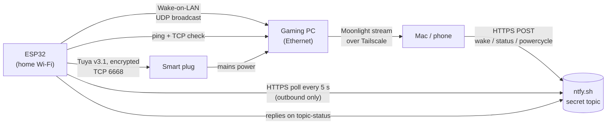
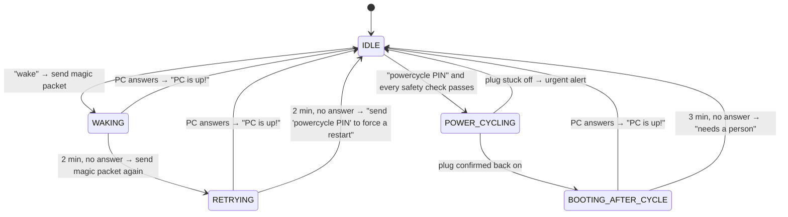

# PC Remote

An ESP32 that lets me turn on my gaming PC from anywhere and stream it to my MacBook, with automatic retries and a smart-plug power-cycle as a last resort when the PC won't come up.

One click on the Mac (Dock app, Raycast or a macOS Shortcut) wakes the PC if it's off, waits until it's ready, and opens the stream in Moonlight.

## Features

- **Wake from anywhere.** Commands travel through [ntfy.sh](https://ntfy.sh); the ESP32 only makes outbound HTTPS requests, so no port forwarding is needed.
- **Wake-on-LAN** from the ESP32 on the home network, since the router can't send magic packets.
- **Recovery state machine.** If the PC doesn't answer after a wake, the ESP32 retries, then offers a **power-cycle through a smart plug**, guarded by multiple safety checks.
- **Status replies** on a separate ntfy topic: "PC is up!", "PC is down...", and every step of a recovery.
- **Encrypted local smart-plug control** using a from-scratch implementation of the Tuya v3.1 protocol (AES-128, MD5 signature, CRC32-framed packets), with no cloud dependency.
- **Unattended reliability:** non-blocking Wi-Fi reconnect, a 30 s task watchdog, HTTP timeouts, and TLS certificate validation.
- **Over-the-air firmware updates** with a password.
- **One-click Mac launcher** that wakes the PC if needed, waits for the stream host, and launches Moonlight.

## Architecture



| Piece | Role |
|---|---|
| **ESP32** (ESP32-WROOM-32) | Always on at home. Polls ntfy, sends Wake-on-LAN, checks the PC, controls the plug. |
| **ntfy.sh** | Message relay. A long random topic name acts as the shared secret. |
| **Gaming PC** | Windows 11, wired Ethernet, Wake-on-LAN enabled. Runs [Apollo](https://github.com/ClassicOldSong/Apollo) (streaming host) and Tailscale as services. |
| **Smart plug** (TECKIN SP10, Tuya) | Last-resort power-cycle. The PC's BIOS is set to power on when AC power returns. |
| **Mac** | Moonlight client plus the one-click launcher in `mac/`. |

## Recovery state machine



### Power-cycle safety

Cutting power to a PC is risky, so the power-cycle is deliberately hard to trigger:

1. **Manual confirmation.** After the retries fail, the ESP32 only *offers* a power-cycle. It happens when I send `powercycle <PIN>`.
2. **Two independent liveness checks.** It refuses if the PC answers **either** ping **or** a TCP connection to the streaming host, checked right before switching. A firewall change alone can't trick it into cutting a running PC.
3. **The plug restores power by itself.** "Off" is sent together with the plug's built-in 15 s countdown in one command, so even if the ESP32 crashes mid-cycle, power comes back. The ESP32 also sends "plug on" at every boot.
4. **Verified, not assumed.** The plug's state is read back after switching off and after the countdown. If it's still off, the ESP32 retries, then sends an alert.
5. **Rate limited.** At most one power-cycle every 6 hours. The time of the last cycle is stored in flash, and the wall clock comes from NTP, so a reboot can't reset the limit. With no time sync, it refuses.

## Commands

Send to the ntfy topic (for example `curl -d "wake" ntfy.sh/<topic>`). Replies arrive on `<topic>-status`.

| Command | What it does | LED |
|---|---|---|
| `wake` | Sends Wake-on-LAN and starts the recovery state machine | 6 blinks |
| `status` | Pings the PC and replies "PC is up..." or "PC is down..." | 4 blinks |
| `powercycle <PIN>` | Requests a safety-checked power-cycle | 3 blinks |
| anything else | "Unknown Command" | 2 blinks |

Commands are trimmed and case-insensitive. On boot, the ESP32 skips the newest cached message so an old `wake` can't fire again after a restart.

## Engineering notes

- **No inbound ports.** The ESP32 polls ntfy (`poll=1&since=<last id>`) instead of listening, so it works behind any router.
- **TLS validation.** ntfy.sh's certificate is checked against the ISRG Root X1 and X2 root certificates (`include/ntfy_cert.h`). Tested by swapping in a wrong root: every request fails.
- **Tuya v3.1 protocol by hand.** Status reads are plain JSON in a CRC32-checked frame. Commands are AES-128-ECB (PKCS7) encrypted, Base64 encoded and signed with MD5. The encryption was verified byte-for-byte against [tinytuya](https://github.com/jasonacox/tinytuya). The plug allows only one local connection at a time, so every failure is treated as "couldn't reach the plug".
- **Never blocks for long.** Every wait uses `millis()` timers. The longest blocking step (an HTTPS request or a plug command) stays well inside the 30 s watchdog, and the OTA upload feeds the watchdog while it runs.
- **Wi-Fi recovery.** Reconnects every 10 s while down, and recalculates the Wake-on-LAN broadcast address once the connection is back.

## Project layout

```
src/
  main.cpp        setup(), loop(), watchdog, poll timer
  wifi_conn.cpp   Wi-Fi connect and reconnect
  ntfy.cpp        polling and publishing (TLS)
  commands.cpp    command parsing
  pc.cpp          Wake-on-LAN, liveness checks, recovery state machine, power-cycle safety
  plug.cpp        Tuya v3.1 driver for the smart plug
  ota.cpp         over-the-air updates
  led.cpp         status LED
include/          headers, ntfy_cert.h, example_secrets.h
mac/              one-click launcher (play.sh, launch.sh, Dock app builder, Raycast command)
```

## Setup

### Hardware and PC
- ESP32 dev board (2.4 GHz Wi-Fi), PlatformIO with the Arduino framework.
- PC BIOS: **ErP** disabled, **Power On By PCI-E** enabled, **Restore AC Power Loss: Power On**.
- Windows: the Ethernet adapter's **Wake on Magic Packet** enabled (this may need the vendor's full LAN driver), **Fast Startup** off, and an inbound ICMPv4 echo rule so ping works.
- A DHCP reservation for the PC on the router.

### Secrets (all gitignored)
1. `include/secrets.h` from `include/example_secrets.h`: Wi-Fi, ntfy topic (`openssl rand -hex 16`), PC MAC and IP, power-cycle PIN, plug IP, ID and local key.
2. `secrets.ini` from `secrets.example.ini`: the OTA password.
3. `mac/config.sh` from `mac/config.example.sh`: ntfy topic, PC Tailscale IP, Moonlight host name.

The plug's local key comes from a free Tuya IoT developer project and `python -m tinytuya wizard`.

### Build and flash
```bash
pio run -t upload                    # first time, over USB
pio run -e esp32dev_ota -t upload    # afterwards, over Wi-Fi (pc-remote.local)
pio device monitor                   # serial log at 115200
```

### Mac launcher
```bash
./mac/play.sh        # wake if needed, wait for the PC, stream
./mac/make-app.sh    # build "Launch Windows.app" for the Dock
```
For Raycast, add `mac/raycast` as a script directory and run "Launch Windows". The launcher pauses Logi Options+ during the stream, because it turns the mouse's side buttons into browser shortcuts that never reach the game.

## Possible next steps
- Automatic power-cycle mode once the manual mode has proven reliable.
- Hardware power-button control through an optocoupler on the motherboard header.
- Decrypting the plug's encrypted status replies instead of treating them as "accepted".
